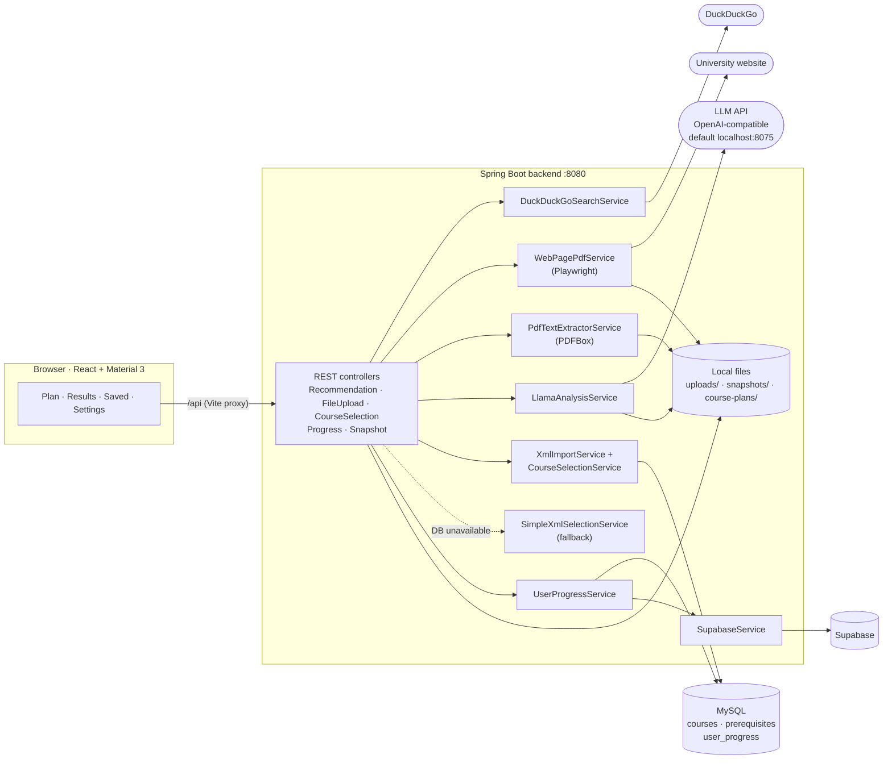
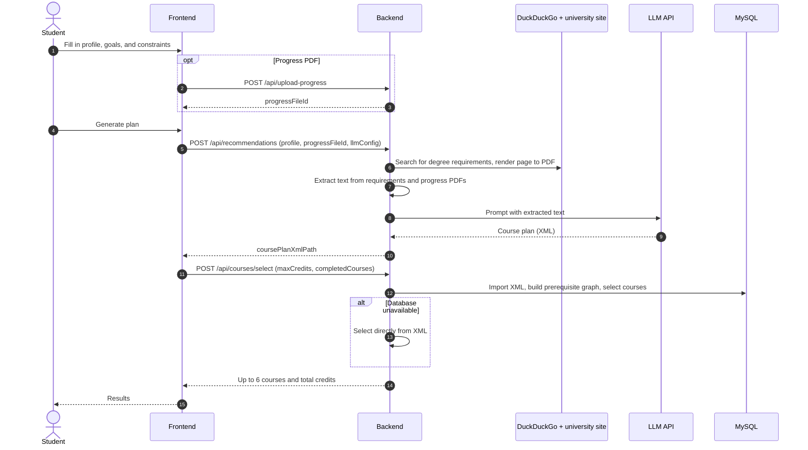

<h1 align="center">CourseGuide</h1>

<p align="center"><strong>Your next semester, planned from your real degree requirements.</strong></p>

<p align="center">
  <a href="https://github.com/Bill092738/AICourseGuide/actions/workflows/ci.yml"></a>
  
  
  
  
</p>

## Team

| Member | GitHub |
| :---: | :---: |
| Bill Zhao | [`Bill092738`](https://github.com/Bill092738) |
| Jasminwzq | [`Jasminwzq`](https://github.com/Jasminwzq) |

---

CourseGuide builds a next-semester course plan from your university's published degree requirements and your academic progress. It finds the requirements page, saves it as a PDF, has an LLM turn it into a structured course plan, and then picks courses that fit your credit limit and prerequisites.

- **Adaptive Material 3 interface** that works on phones, tablets, and desktops, with dynamic color and light/dark themes.
- **Any OpenAI-compatible LLM**: a local llama.cpp or Ollama server, OpenAI, Groq, Together AI, and others.
- **Prerequisite-aware selection** using a course dependency graph stored in MySQL, with an XML-only fallback when the database is unavailable.
- **Save and resume** sessions by case number, stored locally in MySQL or synced to Supabase.

---

## Contents

- [Architecture](#architecture)
- [How a plan is generated](#how-a-plan-is-generated)
- [Tech stack](#tech-stack)
- [Getting started](#getting-started)
- [Configuration](#configuration)
- [API reference](#api-reference)
- [Project structure](#project-structure)
- [Development](#development)
- [Testing and CI](#testing-and-ci)
- [Further documentation](#further-documentation)

---

## Architecture



| Layer | Responsibility |
| --- | --- |
| **Frontend** (`frontend/`) | Collects the student profile, uploads the progress PDF, runs the generate flow, shows selected courses, and manages saved sessions and settings. LLM settings live in the browser and are sent with each request. |
| **Controllers** (`controllers/`) | Thin REST layer that coordinates the services. |
| **Services** (`services/`) | Web search, page-to-PDF rendering, PDF text extraction, LLM prompting, XML import, course selection, file storage, and progress persistence. |
| **MySQL** | Course and prerequisite tables for the dependency graph, plus saved sessions. Tables are created automatically on first use. |
| **Supabase** (optional) | Cloud copy of saved sessions. Local records can be synced to it later. |

---

## How a plan is generated



---

## Tech stack

| Area | Technology |
| --- | --- |
| Frontend | React 19, TypeScript, Vite 7, Tailwind CSS 4 |
| Design system | Material Design 3 via [`@material/web`](https://material-web.dev/), dynamic color from `@material/material-color-utilities` |
| Backend | Java 21, Spring Boot 3.3 (Web, JDBC), Maven |
| Scraping and PDFs | Playwright for Java, jsoup, Apache PDFBox |
| Data | MySQL 8 (HikariCP), optional Supabase |
| AI | Any OpenAI-compatible chat completions API |
| Testing and CI | JUnit 5, Mockito, AssertJ, H2 · Vitest, Testing Library, jsdom · GitHub Actions |

---

## Getting started

### Prerequisites

| Requirement | Version | Notes |
| --- | --- | --- |
| Java | 21+ | |
| Maven | 3.6+ | |
| Node.js and npm | 18+ | |
| MySQL | 8.0+ | Needs a `courseguide_dag` database. Without it, course selection uses the XML fallback, and saving progress locally will fail. |
| LLM server | — | An OpenAI-compatible API. The default is `http://localhost:8075`; you can point to another one in **Settings**. |

Playwright downloads its browser automatically the first time a page is rendered.

### 1. Create the database

```sql
CREATE DATABASE courseguide_dag;
```

The tables are created automatically. The default connection is `root` / `password` on `localhost:3306` (see [Configuration](#configuration)).

### 2. Start everything

```sh
./start.sh
```

The script checks the prerequisites, builds and starts the backend, installs frontend dependencies when `package-lock.json` changes, and starts the frontend. Press `Ctrl+C` to stop both.

| Service | URL |
| --- | --- |
| Frontend | http://localhost:5173 |
| Backend | http://localhost:8080 |
| Health check | http://localhost:8080/api/health |

### Running the services separately

```sh
# Backend
cd backend
mvn clean package
java -jar target/courseguide-0.1.0-SNAPSHOT.jar

# Frontend (in another terminal)
cd frontend
npm install
npm run dev
```

During development, the Vite dev server proxies `/api` to `http://localhost:8080`.

---

## Configuration

### LLM provider

Set this in the app under **Settings → LLM API**. The values are stored in the browser and sent to the backend with each request.

| Field | Description | Default |
| --- | --- | --- |
| API base URL | OpenAI-compatible endpoint, e.g. `https://api.openai.com/v1` | `http://localhost:8075` |
| API key | Provider API key | `LLAMA_API_KEY` environment variable on the backend |
| Model name | e.g. `gpt-4o`, `llama-3.3-70b-versatile` | Discovered from the API's model list |

### Backend

Settings live in [`backend/src/main/resources/application.properties`](backend/src/main/resources/application.properties). Any property can be overridden with an environment variable, using Spring Boot's naming (for example, `spring.datasource.password` becomes `SPRING_DATASOURCE_PASSWORD`).

| Property | Purpose | Default |
| --- | --- | --- |
| `spring.datasource.url` | MySQL JDBC URL | `jdbc:mysql://localhost:3306/courseguide_dag` |
| `spring.datasource.username` / `password` | MySQL credentials | `root` / `password` |
| `supabase.url` | Supabase project URL. Leave empty to keep sessions local only. | empty |
| `supabase.anon-key` | Supabase anon key | empty |

> Keep real credentials out of version control. Set them through environment variables instead.

### Saved sessions

Each session is saved under an 8-character case number made of uppercase letters and digits. In **Saved**, choose a storage mode:

- **Local (SQL)** stores sessions in MySQL.
- **Online (Supabase)** stores sessions in Supabase. If Supabase is unreachable, the session is saved to MySQL and marked as not synced. When you switch to online mode, the app offers to upload any local records that haven't been synced yet.

---

## API reference

All endpoints are under `/api` and use JSON unless noted.

### Planning

| Method | Path | Description |
| --- | --- | --- |
| `POST` | `/upload-progress` | Upload a progress PDF (`multipart/form-data`, field `progressPdf`). Returns `progressFileId`. |
| `POST` | `/recommendations` | Run search, snapshot, and LLM analysis for a student profile. Returns `coursePlanXmlPath` and `coursePlanAvailable`. |
| `POST` | `/recommendations/profile` | Same flow, using a structured `StudentProfile` body. |
| `POST` | `/courses/select` | Select courses from a course plan. Body: `coursePlanXmlPath`, `maxCredits` (default 18), `completedCourses`. |
| `GET` | `/snapshot/pdf?url=` | Render a URL to PDF. |
| `GET` | `/snapshot/pdf/search?query=` | Search, then render the top result to PDF. |
| `GET` | `/health` | Health check. |

### Progress

| Method | Path | Description |
| --- | --- | --- |
| `POST` | `/progress/case-number` | Generate a new case number. |
| `POST` | `/progress/save/local` | Save to MySQL. A case number is generated if none is given. |
| `POST` | `/progress/save/online` | Save to Supabase, falling back to local storage. |
| `GET` | `/progress/load/{caseNumber}?mode=local\|online` | Load a session. |
| `GET` | `/progress/list` | List local sessions, newest first. |
| `DELETE` | `/progress/delete/{caseNumber}` | Delete a local session. |
| `GET` | `/progress/sync/status` | Count of local records not yet synced. |
| `POST` | `/progress/sync` | Upload unsynced local records to Supabase. |

---

## Project structure

```
AICourseGuide/
├── .github/workflows/ci.yml          # GitHub Actions: backend and frontend jobs
├── start.sh                          # One-command build and run
├── backend/                          # Spring Boot service (Maven)
│   ├── pom.xml
│   └── src/
│       ├── main/java/com/courseguide/
│       │   ├── App.java              # Entry point
│       │   ├── config/               # CORS
│       │   ├── controllers/          # REST endpoints
│       │   ├── services/             # Search, PDF render/extract, LLM, XML import, selection, storage, progress, Supabase
│       │   ├── processors/           # Recommendation engine and data processors
│       │   ├── dto/                  # Request records (StudentProfile, LlmConfig, ...)
│       │   ├── models/
│       │   └── utils/                # XML and CSV parsing
│       ├── main/resources/
│       │   ├── application.properties
│       │   └── sql/                  # Schema, sample data, and DAG queries
│       └── test/java/com/courseguide/ # JUnit 5 tests, mirroring main/
├── frontend/                         # React + Vite app
│   ├── vite.config.ts                # Dev server and /api proxy
│   ├── vitest.config.ts
│   └── src/
│       ├── App.tsx                   # Adaptive shell: navigation bar/rail, app bar, FAB
│       ├── pages/                    # Plan, Results, Saved, Settings
│       ├── components/               # Material 3 components and wrappers
│       ├── state/AppState.tsx        # App state and backend calls
│       ├── lib/api.ts                # Typed API client
│       ├── theme/theme.ts            # Dynamic color
│       └── **/*.test.ts(x)           # Vitest tests next to the code they cover
└── docs/                             # MySQL DAG and CSV format notes
```

At runtime the backend writes `uploads/`, `snapshots/`, and `course-plans/` into its working directory (`backend/` when started with `start.sh`). These folders are git-ignored.

---

## Development

```sh
# Frontend
cd frontend
npm run lint      # ESLint
npm test          # Vitest unit tests
npm run build     # Type-check and production build

# Backend
cd backend
mvn verify        # Compile and run unit tests
```

See [`frontend/README.md`](frontend/README.md) for how the frontend applies Material 3: tokens, breakpoints, and components.

---

## Testing and CI

GitHub Actions runs [`.github/workflows/ci.yml`](.github/workflows/ci.yml) on every pull request and on pushes to `main`. The two jobs run in parallel:

| Job | Steps |
| --- | --- |
| Backend | JDK 21 (Temurin) → `mvn -B verify` |
| Frontend | Node 22 → `npm ci` → `npm run lint` → `npm test` → `npm run build` |

The tests need no external services:

- **Backend** (JUnit 5, Mockito, AssertJ). Database code runs against in-memory H2 in MySQL mode, controllers are tested with `@WebMvcTest` and mocked services, and Supabase calls go to `MockRestServiceServer`. Nothing calls MySQL, the LLM, DuckDuckGo, or Playwright. Tests run in `backend/target/test-work` so generated files stay out of the source tree.
- **Frontend** (Vitest, jsdom, Testing Library). Covers the API client, form validation, saved-form parsing, dynamic color, breakpoints, UI components, and the generate/save/load flows with a mocked `fetch`.

Tests marked `@Disabled` describe known bugs. Remove the annotation once the bug is fixed.

---

## Further documentation

| Document | Topic |
| --- | --- |
| [`README_MySQL_DAG.md`](docs/README_MySQL_DAG.md) | MySQL prerequisite graph setup |
| [`DAG_SOLUTION_README.md`](docs/DAG_SOLUTION_README.md) | Graph generation approach |
| [`PURE_MYSQL_DAG_SOLUTION.md`](docs/PURE_MYSQL_DAG_SOLUTION.md) | SQL-only graph solution |
| [`GENERIC_MYSQL_DAG_SOLUTION.md`](docs/GENERIC_MYSQL_DAG_SOLUTION.md) | Generic graph queries |
| [`CSV_FORMAT_DOCUMENTATION.md`](docs/CSV_FORMAT_DOCUMENTATION.md) | Legacy CSV course plan format |
